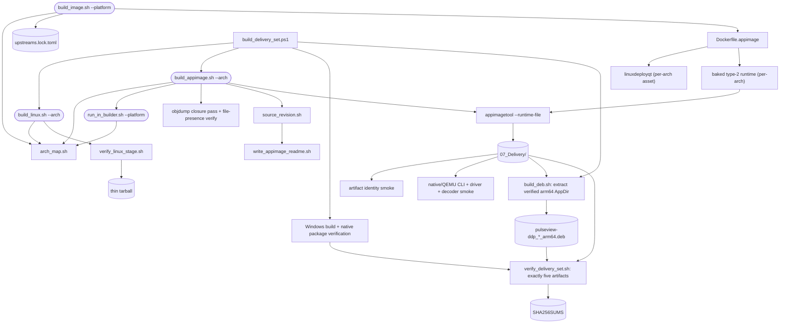

<!--
Copyright (c) 2026 DDP Engineering
This software is licensed under the PolyForm Noncommercial License 1.0.0.
Commercial use requires a separate commercial license.
See the LICENSE.txt in the .agentic folder for full license details.
SPDX-License-Identifier: LicenseRef-PolyForm-Noncommercial-1.0.0
-->

# linux-build-tooling

## Purpose

Builds the sigrok stack and PulseView for Linux - a thin tarball and a
self-contained AppImage - for x86_64 and aarch64 (Raspberry Pi 4/5). It also
turns the verified aarch64 AppImage payload into a native Debian package and
coordinates that with the Windows and Linux packages as one checksummed
five-target delivery set.

## Public interface

- `build_linux.sh [--arch aarch64]` - thin tarball in a plain ubuntu:24.04
  container of the chosen platform.
- `build_appimage.sh [--arch aarch64]` - AppImage via the `appimage`
  builder image; needs `build_image.sh --image appimage
  [--platform aarch64]` to have produced that image first.
- `run_in_builder.sh --image appimage [--platform ARCH]` - stage-2 shell;
  arch-suffixed image tag (`hantek-builder-appimage-arm64`) and volume.
- `arch_map.sh` - sourced, not executed; `ARCH_OVERRIDE` optional; exports
  `SR_ARCH`, `SR_LIBDIR`, `SR_STAGE_NAME`, `SR_TARBALL_SUFFIX`,
  `SR_APPIMAGE_NAME`, `SR_DOCKER_PLATFORM`; unknown architecture fails.
- `source_revision.sh REPOSITORY` - prints short HEAD and appends `-dirty`
  when build inputs differ from it, excluding generated `.work` and
  `07_Delivery` output.
- `verify_linux_stage.sh STAGE` - hard-gates version and both project
  drivers before the thin tarball is written; device-specific show remains
  informational.
- `write_appimage_readme.sh OUT ARCH NAME REV` - emits compatibility and
  provenance text for one supported architecture.
- `build_deb.sh` - checksum-verifies and extracts the aarch64 AppImage, then
  emits `pulseview-ddp_<version>_arm64.deb`, a sidecar hash, and install notes.
- `build_delivery_set.ps1 [-Plan]` - Windows owner command for all five package
  formats; uses WSL/container builders and native Git Bash verification.
- `verify_delivery_set.sh --revision REV DIR` - fail-closed five-row package
  and provenance gate; atomically writes `SHA256SUMS` after hash verification.

## Key behaviors

- `REQ-PLAT-871c1254` - every architecture-dependent name comes from the
  one mapping; the x86_64 row reproduces the historical names byte for byte.
- `REQ-PLAT-aa8d5d46` - aarch64 AppImage on the ubuntu:22.04 (glibc 2.35)
  base so one binary covers Raspberry Pi OS Bookworm and Ubuntu 22.04+.
- `REQ-PLAT-0e73bea7` - the arm64 builder installs only lock-pinned,
  sha256-verified packaging tools.
- `REQ-PLAT-ceeee15c` - check_host.sh probes arm64 container capability and
  names the digest-pinned binfmt one-liner when it is missing.
- `REQ-REL-dc0ff39f` - thin Linux packaging fails closed when the staged
  binary cannot start or omits either project driver.
- `REQ-REL-08b2f2e8` - generated provenance labels distinguish dirty source
  inputs from a clean commit.
- `REQ-PLAT-7c68e538` - the Pi `.deb` installs the verified arm64 payload,
  commands, drivers, decoders, desktop integration, and shared udev rules.
- `REQ-UX-5295dc77` - the installed package appears as PulseView in the menu.
- `REQ-FUNC-d6ba285a` - one owner command sequences the five supported packages.
- `REQ-REL-dae2e62f` - incomplete, duplicate, mixed-revision, or unchecked
  package sets cannot receive the release checksum manifest.

## Architecture

The runtime gate skips explicitly where neither native arm64 nor a configured
emulated arm64 container is available. Actual Docker execution, not a binfmt
file or image metadata alone, determines whether emulation is ready.

One deployer on both architectures - linuxdeployqt release 11 ships an
aarch64 asset. The runtime is baked and passed explicitly because
appimagetool would otherwise fetch it from the network at packaging time;
the closure pass treats the deployer as untrusted either way.

## Files

- `02_Tools/build/arch_map.sh` - the one architecture table.
- `02_Tools/build/build_linux.sh` - thin tarball build.
- `02_Tools/build/build_appimage.sh` - AppImage build, deployer dispatch.
- `02_Tools/build/source_revision.sh` - clean/dirty source identity.
- `02_Tools/build/verify_linux_stage.sh` - fail-closed thin-package gate.
- `02_Tools/build/write_appimage_readme.sh` - architecture-specific README.
- `02_Tools/build/build_deb.sh` - AppImage-derived arm64 Debian assembler.
- `02_Tools/build/build_delivery_set.ps1` - five-target Windows coordinator.
- `02_Tools/build/verify_delivery_set.sh` - same-revision manifest gate.
- `02_Tools/build/build_image.sh` - stage-1 builder-image build, per-arch
  lock reads.
- `02_Tools/build/run_in_builder.sh` - stage-2 container entry.
- `02_Tools/build/images/Dockerfile.appimage` - one Dockerfile, per-arch
  tool install args.
- `02_Tools/bootstrap/check_host.sh` - host readiness incl. arm64 probe.
- `02_Tools/test/arch_map_test.sh`, `arm64_tools_lock_test.sh`,
  `arm64_appimage_smoke.sh`, `arm64_appimage_runtime_smoke.sh`,
  `check_host_arm64_test.sh`, `linux_package_gate_test.sh`,
  `source_revision_test.sh`, `appimage_readme_test.sh` - linked tests.
- `02_Tools/test/deb_package_test.sh`, `delivery_set_test.sh` - Debian payload,
  release-plan, completeness, provenance, duplicate, and checksum assertions.
