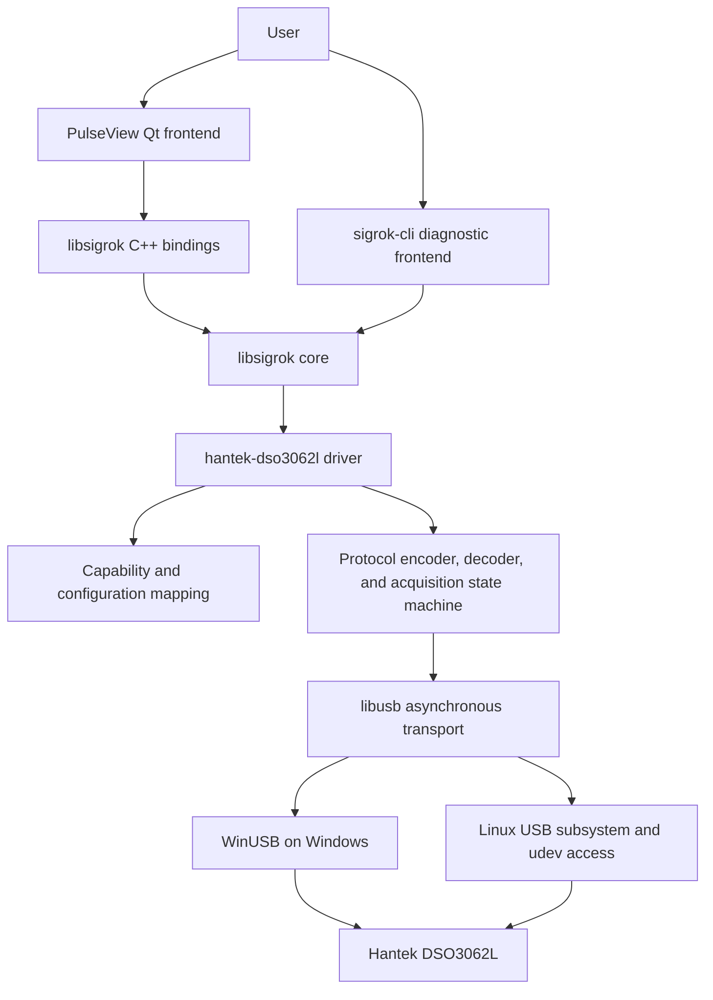
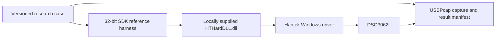
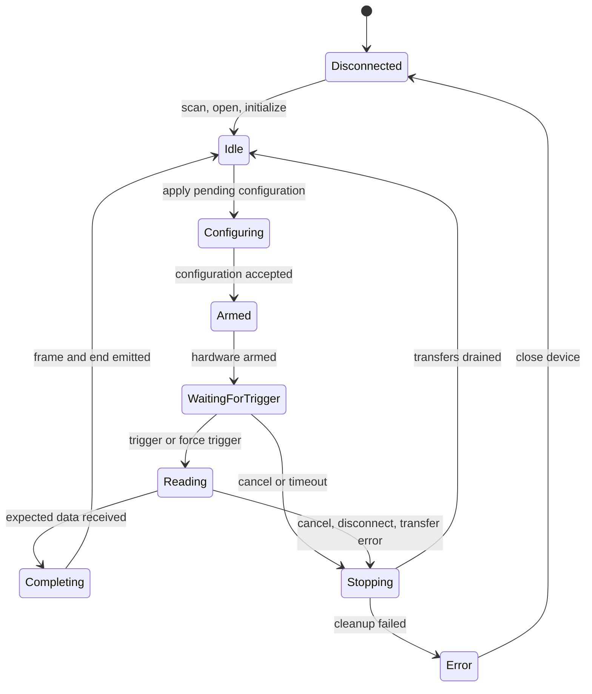

<!--
Copyright (c) 2026 DDP Engineering
This software is licensed under the PolyForm Noncommercial License 1.0.0.
Commercial use requires a separate commercial license.
See the LICENSE.txt file for full license details. SPDX-License-Identifier: LicenseRef-PolyForm-Noncommercial-1.0.0
-->

# Architecture

## System context



PulseView must not call the Hantek SDK. The only normal runtime path is
PulseView or sigrok-cli to libsigrok to the native driver to libusb.

An optional, isolated research path may exist only on Windows:



This path is a behavior oracle, not a fallback production architecture. It
does not communicate with PulseView or libsigrok and is absent from delivery
artifacts.

## Source and licence boundaries

```text
F:\2026_Hantek_DSO3062L                 PolyForm project repository
├── 00_Planning/                         Project planning
├── 01_Documentation/                    Vendor material; redistribution restricted
├── 02_Tools/                            Project-owned bootstrap/build/test/release tools
├── 04_HardwareDocu/                     Derived protocol documentation and capture manifests
├── 05_Software/
│   └── upstream/
│       ├── libsigrok/                   GPL upstream fork, Git submodule
│       └── pulseview/                   GPL upstream fork, Git submodule
├── 06_SoftwareDocu/                     Operator/developer documentation
└── 07_Delivery/                         Generated release records and distributable artifacts
```

Rules:

- Root-owned scripts, tests, and documentation use the repository PolyForm
  header and `01_Documentation/Code_Style.md`.
- Files inside the libsigrok and PulseView submodules follow their upstream
  licence headers and coding styles. Adding a PolyForm header to GPL upstream
  source would make the contribution unsuitable for upstream integration.
- Vendor SDK files remain reference inputs. No vendor binary is copied into an
  upstream repository or delivery artifact without an explicit licence basis.
- Build-only upstream dependencies are cloned at locked revisions into an
  ignored workspace by project scripts; they are not vendored into the root.

## SDK reference-harness boundary

The optional harness is a root-owned research tool built as 32-bit Windows
code. It loads documented exports with `LoadLibraryW` and `GetProcAddress`,
validates every required symbol before touching the device, applies fixed
allocation and sample-count limits, and terminates each experiment on a
bounded timeout. It loads `HTHardDLL.dll` only by default.

Do not guess and invoke undocumented function signatures. Establish an export
only through headers, import tables, disassembly/call-site analysis, or another
reviewable static source before designing a controlled experiment. A crashing
probe is not acceptable protocol research.

The initial harness is a one-process command-line tool, so no IPC is needed. If
a later approved experiment requires a controller process, use a versioned,
length-prefixed schema with fixed-width fields, strict message and capture-size
caps, per-request deadlines, an owner-only named pipe with an unpredictable
session nonce, and a Windows Job Object for child cleanup. Never serialize
vendor structures directly, pass pointers across processes, or expose a
general DLL/function invocation endpoint.

## libsigrok driver design

The initial driver directory is planned as:

```text
src/hardware/hantek-dso3062l/
├── api.c          Driver registration, scan, channels, config get/set/list
├── protocol.c     USB commands, state machine, transfers, data conversion
└── protocol.h     Constants, packed wire structures, device context, helpers
```

Register the driver in `configure.ac`, `Makefile.am`, and `src/drivers.c`, using
the upstream `new-driver` generator where it remains compatible. Keep a new
driver separate from `hantek-dso` and `hantek-4032l` until captured traffic
proves a safe reusable protocol boundary.

### Channel model

| Channels | libsigrok type | Planned grouping |
|---|---|---|
| `CH1`, `CH2` | `SR_CHANNEL_ANALOG` | One group per analog channel |
| `D0`-`D15` | `SR_CHANNEL_LOGIC` | Individual channels; create per-channel configuration groups if independence is proven |
| External trigger | Trigger source, not a sampled channel | Device-level configuration |

The SDK's `laSetVoltDiv()` call receives 16 values and its sample application
initializes all 16 entries. The working hypothesis is therefore one threshold
per logic channel. Characterization must vary one entry at a time; if the
device aliases channels internally, the driver exposes the measured grouping
rather than pretending to provide independent control.

### Configuration surface

Use existing libsigrok keys wherever semantics match:

| Level | Configuration |
|---|---|
| Driver/device | connection, oscilloscope capability, logic-analyzer capability |
| Acquisition | sample rate, sample limit or buffer size, capture ratio, timebase |
| Trigger | match capabilities, source, slope, level |
| Analog group | volts/div, coupling, filter or bandwidth limit |
| Digital channel/group | voltage threshold at the proven hardware granularity |

Every list operation must return only values verified for the connected device.
Every setter validates before transmitting and updates cached state only after
the device command succeeds.

### Acquisition state machine



No USB transfer buffer may outlive its device context. Stop must cancel and
drain every asynchronous libusb transfer before freeing buffers or closing the
handle. Configuration changes during acquisition are rejected with a clear
libsigrok error.

### Data path

1. Arm the device with sample-rate, depth, channel, and trigger configuration.
2. Poll status using bounded timeouts without blocking the libsigrok event loop.
3. Retrieve finite capture buffers after the hardware reports completion.
4. Validate packet lengths, markers, sequence information, and sample count.
5. Split packed analog and logic data using characterized wire rules.
6. Apply device calibration and range scaling to analog samples.
7. Repack digital samples into libsigrok's 16-bit logic sample layout.
8. Emit header/frame-begin, analog and logic datafeed packets, trigger marker,
   frame-end, and end packets in the order required by libsigrok.
9. Return to idle without requiring a USB reconnect.

The implementation must support partial USB transfers and must never emit
uninitialized samples to a frontend. At maximum sample rates, capture occurs in
device memory and is transferred after acquisition; continuous host streaming
is not assumed.

## Trigger architecture

### Tier 1 — existing generic model

Implement first:

- digital low, high, rising, falling, and any-edge matches;
- analog rising/falling slope and trigger level;
- one stage unless hardware evidence establishes a correct multi-stage mapping;
- capture ratio/pre-trigger location;
- force trigger and bounded wait/cancel behavior.

### Tier 2 — documented device modes

Characterize pulse-width, video, and alternate modes. If existing standard
configuration keys can represent them without semantic loss, expose them there.
Otherwise include them in the Tier 3 API proposal.

### Tier 3 — generic advanced-trigger extension

Create an upstream-oriented design before code. It must represent at least:

- bus value plus mask;
- value range and inside/outside relation;
- duration or pulse-width minimum/maximum/range;
- value combined with an edge;
- data, duration, and relative trigger forms supported by the DSO3062L;
- device capability discovery and validation;
- serialization through libsigrok C and C++ bindings;
- a PulseView editor that does not depend on the Hantek driver name.

The proposal must preserve existing simple-trigger callers. Do not encode a
complex trigger as an undocumented driver-specific string or overload the
single float field with device-specific meaning.

## PulseView design

No PulseView code is required for the core driver if standard `sr_config`
properties are sufficient. Advanced-trigger work is isolated to:

- C++ binding exposure from libsigrok;
- a trigger-domain model owned by PulseView;
- an editor capable of stages, channel/bus operands, comparisons, edges, and
  duration units;
- capability-driven validation and disabled states;
- session persistence compatible with older simple triggers;
- unit tests for model conversion and UI-independent validation.

Keep the editor separate from trace rendering. PulseView sends a completed
generic trigger description to the libsigrok session; the driver translates it
to DSO3062L protocol structures.

## Observability and failure handling

- Use `sr_err`, `sr_warn`, `sr_info`, `sr_dbg`, and `sr_spew`; never print
  directly from an upstream driver.
- Log state transitions, command identifiers, byte counts, and libusb status,
  but never dump full user captures at normal log levels.
- Distinguish invalid configuration, unsupported capability, timeout, short
  transfer, protocol violation, cancellation, disconnection, and calibration
  failure.
- Bound every poll, read, and cancellation path.
- On a protocol violation, stop acquisition, drain transfers, emit no corrupt
  frame, and keep the device reusable where safe.

## Security and safety boundaries

- Parse all device lengths as untrusted and check overflow before allocation.
- Cap allocations using a characterized maximum capture depth.
- Validate endpoint, interface, packet marker, channel count, sample count, and
  transfer sequence before decoding.
- Never execute SDK-provided text, build captures into shell commands, or pass
  capture data through `eval`-like mechanisms.
- Keep hardware research inputs below the oscilloscope and logic-probe limits;
  use a known safe signal source and common ground.
