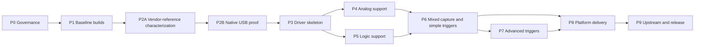

<!--
Copyright (c) 2026 DDP Engineering
This software is licensed under the PolyForm Noncommercial License 1.0.0.
Commercial use requires a separate commercial license.
See the LICENSE.txt file for full license details. SPDX-License-Identifier: LicenseRef-PolyForm-Noncommercial-1.0.0
-->

# Implementation roadmap

## Execution model

Use one AEGIS task per phase below. Each task takes the full path unless it is a
small documentation correction covered by an existing requirement. A later
phase may start only when the previous phase's exit gate is recorded, except
for offline unit-test infrastructure that does not depend on unknown protocol
values.

Focused checks run during each task. Complete upstream suites, platform builds,
and hardware acceptance run at the phase gates and before delivery.

## Dependency sequence

## P0 — governance, licences, and source layout

Actions:

1. Repair the repository-local AEGIS payload.
2. Obtain explicit authorization for Git initialization and submodules.
3. Define root, upstream-fork, vendor-material, capture, and delivery licence
   boundaries.
4. Review the Hantek SDK and driver package for licence and redistribution
   terms; record found documents and unresolved questions.
5. Create or identify user-owned libsigrok and PulseView forks.
6. Add the upstream lock schema and bootstrap script specifications.
7. Add security rules for USB parsers, capture data, generated packages, and
   external tools.

Outputs:

- initialized and governed root repository;
- working AEGIS status/check flow;
- source/licence boundary decision record;
- approved upstream fork URLs;
- locked-input manifest.

Exit gate: G0 from the feasibility document.

## P1 — reproducible baseline builds

Actions:

1. Implement host checks and upstream clone/verification scripts.
2. Build unmodified libserialport, libsigrok, libsigrokdecode, sigrok-cli, and
   PulseView in a pinned Linux environment.
3. Run libsigrok `make check` and PulseView `ctest`.
4. Launch sigrok-cli and PulseView against their isolated prefix.
5. Produce the first Windows x64 cross-build spike using MXE, even before the
   device driver exists, to expose toolchain debt early.
6. Record build logs, dependency versions, hashes, and known upstream warnings.

Outputs:

- `build_linux.sh` baseline mode;
- `build_windows_mxe.sh` baseline mode;
- machine-readable build records;
- no project code changes inside upstream repositories.

Exit gate: G1; Windows cross-build failures may remain as an explicit P8 issue
only if Linux baseline is green and the exact blocker is recorded.

## P2A - vendor-reference characterization

Actions:

1. Inventory the connected device and current Windows driver without changing
   the driver.
2. Install capture tooling only with explicit approval.
3. Capture one variable at a time using the official application.
4. If the application is insufficient, build the optional 32-bit SDK reference
   harness described by the architecture; keep it standalone and research-only.
5. Correlate each UI or documented SDK action with one USBPcap trace and a
   versioned result manifest.
6. Complete the capture matrix before replacing the vendor driver.

Outputs:

- read-only host/device/driver inventory;
- official-application captures and, if used, SDK-reference harness results;
- driver rollback procedure and vendor binary hashes;
- open questions and discrepancies updated in the risk register.

Exit gate: baseline behavior is reproducible and the native-protocol work has
an adequate oracle. G1A applies only if the optional harness is used.

## P2B - native USB protocol proof

Actions:

1. Decode descriptors, endpoints, command framing, status responses, data
   framing, calibration reads, and acquisition flow.
2. Compare evidence with `hantek-4032l` and `hantek-dso`; reuse only proven
   protocol concepts.
3. Build an isolated protocol probe that uses libusb and no vendor DLL.
4. Switch Windows to WinUSB only after `[HUMAN]` approval and rollback proof.
5. Complete one safe setting change and one analog-plus-logic capture.
6. Repeat discovery and the same proof on native Linux.

Outputs:

- USB descriptor record and protocol command catalogue;
- hashed capture manifest and minimized test fixtures;
- protocol probe source and tests;
- identified firmware/calibration dependencies;
- discrepancy log for manual versus measured behavior.

Exit gate: G2. Do not begin the production driver without this proof.

## P3 — driver skeleton, discovery, and lifecycle

Actions:

1. Generate the upstream driver skeleton `hantek-dso3062l`.
2. Register it in libsigrok build and driver lists.
3. Add USB profile `04b5:3062`, connection filtering, channel declarations,
   channel groups, and device metadata.
4. Implement scan, open, interface claim, initialization, close, and cleanup.
5. Implement the acquisition state machine with dependency-injected or fixture
   backed transport seams where upstream test structure permits it.
6. Add udev identification to libsigrok's contributed rules.
7. Test absent device, wrong device, busy interface, open failure, unplug, and
   repeated open/close.

Outputs:

- discoverable libsigrok driver;
- lifecycle and parser unit tests;
- sigrok-cli scan evidence on Linux and Windows/WinUSB when available.

Exit gate: 100 repeated open/close cycles without a crash, leaked transfer, or
required process restart.

## P4 — analog oscilloscope support

Implement in this order:

1. channel enable/disable and CH1/CH2 groups;
2. volts/div table and range validation;
3. AC/DC coupling and documented filter/bandwidth settings;
4. timebase, sample rate, memory depth, and capture ratio;
5. calibration read and analog conversion;
6. acquisition arm/status/read/stop;
7. analog datafeed packets with units, scale, and timing metadata;
8. trigger source CH1/CH2/EXT, slope, level, pre-trigger ratio, and force;
9. repeated captures and cancellation.

Acceptance evidence:

- known DC levels across ranges;
- known sine/square frequency across timebases;
- both channels separately and simultaneously;
- trigger marker within characterized tolerance;
- no clipped or stale samples after configuration changes.

## P5 — logic-analyzer support

Implement in this order:

1. D0-D15 channel declaration and independent enable state;
2. D0-D15 threshold configuration at the independently proven granularity;
3. per-channel threshold conversion and alias table from device-backed
   measurements;
4. logic sample-rate and depth combinations;
5. packed stream decoding and bit-order tests;
6. simple digital trigger matches;
7. logic datafeed packets and disabled-channel behavior;
8. repeat, cancel, timeout, and unplug recovery.

Acceptance evidence:

- walking-one and walking-zero patterns over all 16 inputs;
- each D0-D15 threshold entry varied independently around known input levels;
- representative sample rates and maximum supported depth;
- simple trigger tests for each supported match type.

## P6 — synchronized mixed-signal acquisition

Actions:

1. Enable analog and logic channel combinations concurrently.
2. Determine whether streams share a clock, trigger position, sample count, and
   start point; document any required resampling or alignment metadata.
3. Emit ordered frame packets accepted by sigrok-cli and PulseView.
4. Validate mixed trigger sources and trigger markers.
5. Implement device buffer limits, transfer chunking, partial transfer handling,
   and clean rearm.
6. Expose all standard properties through PulseView's generated device UI.
7. Save and reopen a representative capture.

Exit gate: G3 and G4. This is the minimum useful product milestone.

## P7 — advanced trigger API and UI

Split into separate upstream reviewable changes:

1. Write an API proposal based on verified DSO3062L semantics and survey of
   other drivers; request upstream feedback before freezing ABI.
2. Extend libsigrok C types, validation, lifecycle, documentation, and tests.
3. Extend libsigrok C++ bindings and binding tests.
4. Implement DSO3062L translation from generic trigger expressions to wire
   fields.
5. Add a PulseView trigger model and capability-driven editor.
6. Add persistence and migration for existing simple triggers.
7. Add UI-independent tests for valid, invalid, and unsupported expressions.
8. Validate pulse width, bus value, duration, value-plus-edge, data, and
   relative modes supported by both protocol and approved generic API.

Do not block the core driver contribution on this phase if upstream prefers
separate review. Record unsupported advanced modes explicitly until complete.

Exit gate: G5.

## P8 — Windows and Linux delivery

Actions:

1. Harden Linux native and reproducible-container builds.
2. Package Linux portable bundle and AppImage; add udev rule deployment.
3. Harden Windows x86_64 MXE build and NSIS/portable ZIP packaging.
4. Document manual driver switching between Hantek and WinUSB; add a read-only
   verification tool, not an automatic driver replacer.
5. Generate dependency, licence, provenance, and checksum manifests.
6. Test clean install, upgrade, coexistence, rollback, and removal.
7. Verify that no Hantek proprietary binary enters an artifact unintentionally.

Exit gate: G6 independently for each platform.

## P9 — upstream contribution and project release

Actions:

1. Rebase each upstream fork on its reviewed upstream revision and rerun the
   complete affected project suite.
2. Split changes into reviewable commits: skeleton, protocol/lifecycle, analog,
   logic/mixed capture, trigger API, and PulseView UI as applicable.
3. Prepare upstream documentation, supported-hardware entries, udev rules, and
   sample logs without private or proprietary data.
4. Present exact commit/push/request actions for explicit owner authorization.
5. Build project delivery artifacts only from clean locked revisions.
6. Produce release notes, changelog, manifest, checksums, known limitations,
   hardware evidence index, and reproducibility record.
7. Perform final Windows and Linux acceptance on the exact candidate bits.

Exit gate: all requirements active or deliberately deferred with owner-approved
limitations; delivery artifacts reproduce and verify; publication is separately
authorized.
