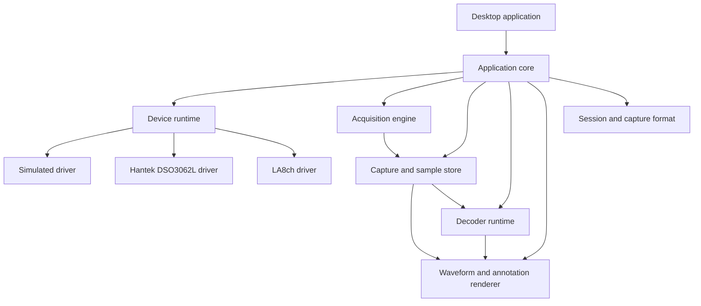
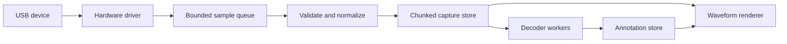
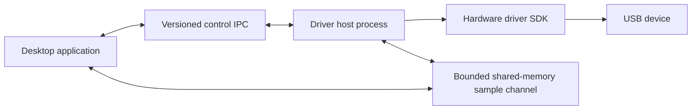

<!--
Copyright (c) 2026 DDP Engineering
This software is licensed under the PolyForm Noncommercial License 1.0.0.
Commercial use requires a separate commercial license.
See the LICENSE.txt file for full license details. SPDX-License-Identifier: LicenseRef-PolyForm-Noncommercial-1.0.0
-->

# Independent Signal-Acquisition Application

## Architecture and agentic implementation plan

## 1. Purpose and decision status

This document proposes a new, independent desktop application for mixed-signal
acquisition, visualization, and protocol analysis. PulseView and sigrok are
behavioral and architectural references; the proposed product is not a source
rewrite and does not require the PulseView, libsigrok, or libsigrokdecode
runtime stacks.

The first product increment supports:

- Hantek DSO3062L analog acquisition;
- a separately identified eight-channel USB logic analyzer, referred to here
  as LA8ch;
- analog and digital waveform visualization;
- UART, I2C, and SPI decoding;
- Windows and Linux deployment;
- saved captures and sessions;
- offline-capable development after a controlled dependency download; and
- portable runtime archives that do not download components when executed.

This proposal is an alternative to the existing Hantek-to-PulseView
integration plan. It does not authorize stopping that work. A project decision
must select whether this application becomes the primary direction, a parallel
experiment, or a later product.

The exact LA8ch manufacturer, model, USB VID/PID, firmware, and protocol are
open inputs. No implementation agent may infer an FX2 or another chipset merely
from the generic device description.

## 2. Architectural objectives

The architecture shall make two operations routine:

1. adding a new hardware driver without editing waveform, decoder, or
   application-specific code; and
2. adding a new protocol decoder without knowing which device produced the
   samples or editing the main UI.

The additional objectives are:

- one normalized capture model for all hardware;
- explicit capabilities instead of device-name conditionals;
- bounded memory and deterministic cancellation;
- efficient display of captures larger than available RAM;
- testability without connected hardware;
- stable, versioned extension metadata;
- an application that never requires network access at runtime;
- reproducible platform-specific builds from locked inputs; and
- a repository that an agent can bootstrap, inspect, build, test, and package
  without relying on undocumented global state.

## 3. Initial non-goals

The first release does not need:

- all PulseView hardware drivers;
- all libsigrokdecode protocols;
- user-installable native binary plugins;
- multiple synchronized physical devices;
- continuous multi-hour recording;
- firmware update functionality;
- an online plugin marketplace;
- cloud storage, telemetry, or automatic updating; or
- pixel-for-pixel compatibility with PulseView.

These capabilities may be added after the core extension contracts have been
proven. They must not distort the first acquisition path.

## 4. Recommended technology baseline

### 4.1 Language

Use stable Rust, pinned by an exact `rust-toolchain.toml`. Rust provides a
native Windows and Linux toolchain, strong control over buffer ownership and
concurrency, and executables that do not require a separate language runtime.
Rustup supports directory-specific toolchain selection and configurable local
toolchain storage:

- [Rustup toolchain concepts](https://rust-lang.github.io/rustup/concepts/toolchains.html)
- [Rustup override and rust-toolchain files](https://rust-lang.github.io/rustup/overrides.html)

The toolchain version is a release input. Agents may not update it implicitly.

### 4.2 Desktop UI and rendering

Use `egui` through `eframe`, initially with the `wgpu` rendering backend.
`eframe` supports native desktop applications and selectable rendering
backends, while `egui` uses permissive MIT or Apache-2.0 licensing:

- [eframe documentation](https://docs.rs/eframe/latest/eframe/)
- [egui repository and licensing](https://github.com/emilk/egui)

The waveform canvas shall use a dedicated renderer. Ordinary UI widgets are
appropriate for controls, menus, dialogs, and configuration, but not for
drawing millions of samples.

### 4.3 USB transport

Use `nusb` as the first transport candidate. It is a pure-Rust USB library
that uses WinUSB on Windows and Linux usbfs on Linux. Linux access still
requires suitable device permissions or udev rules:

- [nusb documentation](https://docs.rs/nusb/latest/x86_64-pc-windows-msvc/nusb/index.html)

This choice must be confirmed with enumeration, control-transfer, bulk-transfer,
cancellation, and sustained-throughput spikes against both target devices.
The architecture places USB behind a transport interface so a blocking
device-specific limitation does not require rewriting the driver model.

### 4.4 Supporting libraries

Expected library categories include:

- `serde` for manifests and configuration;
- `tracing` for structured diagnostics;
- bounded asynchronous channels for acquisition pipelines;
- `zstd` for capture-block compression;
- ZIP support for capture containers and delivery tooling; and
- property and fuzz testing for packet and capture parsers.

Every selected dependency shall be version-locked, vendored for offline builds,
recorded with its source and hash, and included in the licence inventory.

## 5. System architecture



The core defines domain contracts and coordinates components. It contains no
Hantek commands, LA8 packet formats, UART state machines, or device-name UI
switches.

### 5.1 Application shell

The desktop shell owns:

- window and workspace management;
- device discovery and connection commands;
- capability-derived acquisition controls;
- start, stop, cancel, and progress actions;
- waveform navigation and measurements;
- decoder configuration;
- capture and session management;
- user-facing errors; and
- diagnostics export.

The UI renders controls from driver capabilities. For example, a driver
advertises its supported voltage ranges, and the generic UI renders the
selector. The UI must not test for a Hantek model name to decide which selector
to show.

### 5.2 Core domain types

The core owns stable, device-neutral types:

- driver, device, and channel identifiers;
- channel kinds: analog, digital, and derived;
- sample clock and acquisition depth;
- trigger configuration and trigger position;
- acquisition request and validated configuration;
- capture progress and termination reason;
- analog and digital sample blocks;
- capture gaps and discontinuities;
- decoder annotations and structured values; and
- typed errors and warnings.

Time is stored as an integer sample index plus a rational sample period.
Floating-point time is calculated only for display. This avoids cumulative
rounding drift and keeps annotations aligned with raw samples.

## 6. Hardware extension architecture

### 6.1 Version 1 driver model

Each built-in driver is an independent Rust crate under
`05_Software/drivers/`, but it is statically linked into the release
application:

```text
drivers/
|-- simulated/
|-- hantek-dso3062l/
`-- la8ch/
```

Static linking is deliberate for the first release:

- the portable archive contains all required drivers;
- the compiler checks interface compatibility;
- there is no native plugin search path;
- the application cannot fail because a required driver DLL is absent; and
- the project avoids exposing unstable Rust trait layouts as a binary ABI.

Adding a built-in driver requires rebuilding the application, but should not
require changes to application-core or UI code.

### 6.2 Conceptual device contracts

```rust
trait DeviceDriver {
    fn descriptor(&self) -> DriverDescriptor;
    async fn enumerate(&self) -> Result<Vec<DeviceCandidate>>;
    async fn open(
        &self,
        candidate: &DeviceCandidate,
    ) -> Result<Box<dyn Device>>;
}

trait Device {
    fn capabilities(&self) -> DeviceCapabilities;
    async fn configure(
        &mut self,
        requested: AcquisitionConfiguration,
    ) -> Result<ValidatedConfiguration>;
    async fn start_capture(&mut self) -> Result<CaptureStream>;
    async fn cancel(&mut self) -> Result<()>;
    async fn close(self: Box<Self>) -> Result<()>;
}
```

These signatures are illustrative. The detailed design must define ownership,
thread-safety, cancellation, and stream termination precisely before the
hardware implementations begin.

A driver shall not access:

- UI objects;
- renderer state;
- session documents;
- protocol decoders; or
- mutable global application state.

### 6.3 Capability descriptor

Each driver exposes a versioned descriptor containing:

- stable driver ID and display name;
- driver and hardware-API versions;
- supported USB identities;
- channel types and counts;
- sample rates and acquisition depths;
- voltage ranges, coupling, attenuation, and threshold controls;
- clock and synchronization features;
- trigger sources, conditions, stages, and limits;
- firmware and calibration requirements; and
- known limitations.

Triggers use a capability tree rather than a fictional universal trigger.
A device may advertise edge direction, analog level, digital pattern, pulse
width, pre-trigger percentage, or multi-stage support independently. The UI
offers only valid combinations.

### 6.4 Acquisition engine

The acquisition engine sits between device streams and storage:



It shall:

- validate block sizes, sequence numbers, and channel layouts;
- attach calibration and clock metadata;
- record gaps and dropped blocks explicitly;
- retain the trigger position;
- use bounded queues;
- prioritize lossless acquisition over live decoding;
- support deterministic cancellation;
- close or recover partial captures safely; and
- convert driver errors into typed application events.

If decoding falls behind, it pauses and resumes from stored data. Decoder load
must not cause unbounded RAM growth or silently drop acquisition data.

### 6.5 Future external hardware plugins

Do not use direct Rust dynamic-library plugins. Rust does not provide a stable
ABI for arbitrary traits across independently compiled libraries.

If third-party runtime installation becomes a requirement, introduce a
separate driver-host process:



Control messages use versioned typed DTOs. Large sample streams use bounded
shared memory or another binary bulk channel rather than JSON. A failed
third-party driver then terminates its host instead of corrupting the desktop
process.

## 7. Protocol decoder architecture

### 7.1 Independence from hardware

A decoder receives normalized capture data and channel assignments. It does
not know which USB driver produced the data.

Conceptually:

```rust
trait DecoderFactory {
    fn descriptor(&self) -> DecoderDescriptor;
    fn create(
        &self,
        configuration: DecoderConfiguration,
    ) -> Result<Box<dyn Decoder>>;
}

trait Decoder {
    fn reset(&mut self, capture: &CaptureDescriptor) -> Result<()>;
    fn process(
        &mut self,
        cursor: &mut TransitionCursor,
        output: &mut DecoderOutput,
    ) -> Result<DecoderProgress>;
    fn finish(&mut self, output: &mut DecoderOutput) -> Result<()>;
}
```

The central abstraction is `TransitionCursor`. A decoder can:

- query the current state of one or more channels;
- wait for a rising or falling edge;
- wait for any relevant channel transition;
- advance a known number of samples;
- seek to a sample; and
- distinguish a data transition from a capture gap.

The sigrok decoder API also uses event-oriented waiting rather than requiring
every decoder to scan every sample, and this behavior is a useful independent
design reference:

- [sigrok protocol decoder API](https://sigrok.org/wiki/Protocol_decoder_API)

### 7.2 Decoder manifest

Every decoder declares:

- stable decoder ID;
- name, description, and version;
- decoder-API version;
- licence;
- required and optional channels;
- configuration option schemas;
- annotation rows and classes;
- structured output schemas;
- live-decoding support;
- streaming-finalization behavior; and
- compatible stacked inputs and outputs, when implemented.

The generic UI renders decoder configuration from this manifest. Adding a
decoder does not add a decoder-specific dialog to the desktop application.

### 7.3 Structured decoder output

An annotation contains:

- start and end sample;
- decoder-instance ID;
- row and class IDs;
- short, normal, and detailed display text;
- an optional typed value;
- warning or error severity; and
- optional parent/transaction identity.

Structured results allow searching, filtering, CSV/JSON export, automated
tests, packet tables, and future decoder stacking. Display strings alone are
not an adequate decoder interface.

### 7.4 Initial decoder behavior

UART shall support:

- configurable baud rate;
- data bits;
- parity and stop bits;
- bit order where applicable;
- signal inversion;
- start-bit validation;
- parity and framing errors; and
- break detection.

I2C shall support:

- START, repeated START, and STOP;
- address and read/write direction;
- data bytes;
- ACK and NACK;
- incomplete transactions;
- clock-stretch representation; and
- optional basic glitch filtering.

SPI shall support:

- CPOL and CPHA modes;
- MSB-first and LSB-first order;
- configurable word size;
- optional chip select;
- active-high and active-low select;
- MISO and MOSI;
- partial words; and
- configurable annotation grouping.

Each decoder begins with synthetic waveform fixtures and structured golden
outputs. Screenshot comparison is supplementary and cannot replace semantic
decoder tests.

### 7.5 Future external decoder plugins

Version 1 decoders are Rust crates statically linked into the application.
If installable third-party decoders are later required, use WebAssembly/WASI
rather than native DLLs. The host provides a bounded cursor and annotation API,
with execution-time and memory limits. The plugin does not receive unrestricted
filesystem, USB, process, or network access.

## 8. Sample storage and rendering

### 8.1 Analog representation

Store raw ADC values as integers and retain calibration separately:

- scale;
- offset;
- probe attenuation;
- input range;
- coupling;
- calibration revision; and
- uncertainty or saturation flags.

Convert to volts lazily. Generate min/max summary levels for progressively
larger sample windows so a zoomed-out screen reads an appropriate level rather
than scanning the complete capture.

### 8.2 Digital representation

Store packed samples using the smallest suitable word and retain an explicit
channel-to-bit mapping. Build transition indexes by channel or channel group.
The renderer and decoder cursor query transitions instead of scanning every
sample.

### 8.3 Chunk store

Each capture chunk records:

- start sample and sample count;
- channel group;
- encoding and compression;
- source sequence information;
- checksum;
- clock-domain identity; and
- discontinuity markers.

Large temporary captures use memory-mapped files under `.work/`. They are not
written to `07_Delivery/` and are recoverable or disposable according to the
session state.

### 8.4 Waveform renderer

For analog channels:

- use the min/max pyramid at low zoom;
- draw a vertical min/max range per screen column;
- use raw samples only at sufficient zoom; and
- preserve explicit saturation and gap indications.

For digital channels:

- draw stable runs as horizontal segments;
- query only transitions in the visible interval;
- show unknown and gap states distinctly; and
- avoid one draw call per raw sample.

For decoder rows:

- keep annotations in an interval index;
- query only the visible interval;
- select short or detailed text based on available width; and
- preserve row and transaction grouping.

## 9. Capture and session format

Use a documented, versioned container. A possible layout is:

```text
capture.scopezip
|-- manifest.json
|-- session.json
|-- channels.json
|-- samples/
|   |-- analog-0000.bin.zst
|   `-- digital-0000.bin.zst
|-- indexes/
|   |-- transitions-0000.bin
|   `-- summaries-0000.bin
|-- annotations/
|   `-- decoder-results.cbor.zst
`-- diagnostics/
    `-- acquisition.json
```

The format shall have:

- a magic value in addition to a file extension;
- major and minor format versions;
- checksums;
- bounded allocation and decompression rules;
- recovery rules for interrupted captures;
- unknown-field compatibility rules;
- device, driver, firmware, and calibration provenance;
- trigger, clock, gap, and dropped-data metadata; and
- optional cached decoder results.

Raw samples remain available so improved decoders can be run again. Capture
files are untrusted inputs and their parsers require fuzzing and resource
limits.

## 10. Repository structure

The project shall retain the existing numbered layout contract:

```text
/
|-- AGENTS.md
|-- README.md
|-- CHANGELOG.md
|-- LICENSE.txt
|-- Cargo.toml
|-- Cargo.lock
|-- rust-toolchain.toml
|-- .cargo/
|   |-- config.toml
|   `-- README.md
|-- .agentic/
|-- 00_Planning/
|-- 01_Documentation/
|   |-- Architecture/
|   |-- Development/
|   |-- Driver_SDK/
|   |-- Decoder_SDK/
|   `-- Capture_Format/
|-- 02_Tools/
|   |-- bootstrap/
|   |-- build/
|   |-- package/
|   |-- release/
|   |-- fixtures/
|   `-- xtask/
|-- 04_HardwareDocu/
|   |-- Hantek_DSO3062L/
|   `-- LA8ch/
|-- 05_Software/
|   |-- apps/
|   |   |-- desktop/
|   |   `-- capture-cli/
|   |-- crates/
|   |   |-- core-types/
|   |   |-- app-core/
|   |   |-- device-api/
|   |   |-- decoder-api/
|   |   |-- acquisition/
|   |   |-- sample-store/
|   |   |-- waveform-renderer/
|   |   |-- capture-format/
|   |   `-- diagnostics/
|   |-- drivers/
|   |   |-- simulated/
|   |   |-- hantek-dso3062l/
|   |   `-- la8ch/
|   `-- decoders/
|       |-- test-pattern/
|       |-- uart/
|       |-- i2c/
|       `-- spi/
|-- 06_SoftwareDocu/
|-- 07_Delivery/
|-- vendor/
`-- .work/
```

Every permanent folder contains a README that states:

- what belongs in the folder;
- what is prohibited;
- whether files are tracked or generated;
- which script owns generated contents; and
- the relevant validation or delivery boundary.

All project-owned scripts remain under `02_Tools/`. Intermediate build and
capture artifacts remain under `.work/`. Only final verified packages enter
`07_Delivery/`.

## 11. Self-contained development environment

There are two separate deliverables:

1. a development kit used to build and test the project offline; and
2. a runtime package used by an end user without development tools.

### 11.1 Bootstrap entry points

The only hand-maintained bootstrap launchers should be:

```text
02_Tools/bootstrap/bootstrap.ps1
02_Tools/bootstrap/bootstrap.sh
```

They shall:

1. derive the repository root from their own path;
2. detect host platform and architecture;
3. read a pinned dependency manifest;
4. download exact tool and dependency versions;
5. verify every external artifact hash;
6. place tool state under repository-local roots;
7. populate the Cargo vendor directory;
8. generate licence and dependency inventories;
9. perform a small build with networking disabled; and
10. write a machine-readable bootstrap record.

No script may silently install global software, modify USB drivers, initialize
Git, create a branch, commit, push, or publish.

### 11.2 Cargo dependency closure

Commit `Cargo.lock`. Use `cargo vendor` and Cargo source replacement to
resolve registry dependencies from a local directory:

- [Cargo source replacement](https://doc.rust-lang.org/cargo/reference/source-replacement.html)

The offline proof uses:

```text
cargo build --workspace --frozen
```

Cargo documents `--frozen` as the combination of locked dependency
resolution and offline mode:

- [Cargo build options](https://doc.rust-lang.org/cargo/commands/cargo-build.html)
- [Cargo offline configuration](https://doc.rust-lang.org/cargo/reference/config.html)

The proof must be run with network access denied, not merely with the
expectation that Cargo will avoid the network.

### 11.3 Development kits

Produce platform-specific kits:

```text
Application-devkit-windows-x86_64.zip
Application-devkit-linux-x86_64.tar.zst
```

Each contains:

- source snapshot and Git revision;
- Cargo lockfile and vendored crates;
- pinned Rust toolchain;
- formatting and lint components;
- project tooling;
- driver and decoder scaffolds;
- dependency and licence manifests;
- artifact hashes; and
- offline instructions.

After extraction and environment activation, a developer should be able to
disconnect the network and run doctor, build, test, and package commands.

Windows and Linux development kits remain separate because compiler and host
tools differ. The Windows MSVC target requires the appropriate Microsoft build
tools and Windows SDK during compilation. Redistribution of those components
must follow their licences; a licensed offline layout or prepared internal
builder may be necessary. This restriction does not require build tools on an
end-user machine.

A pinned Linux builder should use the oldest supported distribution baseline
to limit accidental dependencies on a newer glibc. An offline-loadable OCI
builder image may supplement, but not replace, the documented native
development kit.

## 12. Project build interface

After bootstrap, use a project-owned Rust `xtask`:

```text
cargo xtask doctor
cargo xtask vendor
cargo xtask build --profile development
cargo xtask build --profile release --offline
cargo xtask test
cargo xtask test-hardware --device hantek-dso3062l
cargo xtask new-driver <driver-id>
cargo xtask new-decoder <decoder-id>
cargo xtask package --platform windows-x86_64
cargo xtask package --platform linux-x86_64
cargo xtask verify-package <archive>
cargo xtask create-devkit --platform <platform>
```

`doctor` reports:

- toolchain and target versions;
- vendor-directory and offline status;
- native build prerequisites;
- USB permissions;
- recognized connected devices;
- hash and licence-manifest consistency; and
- package readiness.

All commands take explicit paths or derive paths from their own location. They
must not depend on the caller's working directory.

## 13. Portable runtime packages

Produce one artifact per platform:

```text
Application-<version>-windows-x86_64.zip
Application-<version>-linux-x86_64.zip
```

A single universal Windows-and-Linux archive is not a realistic target.

### 13.1 Windows archive

```text
Application/
|-- Application.exe
|-- assets/
|-- plugins/
|-- licences/
|-- examples/
|-- README.txt
|-- DRIVER_SETUP.txt
|-- build-manifest.json
|-- sbom.json
`-- SHA256SUMS
```

The package shall:

- include every required first-party driver and decoder;
- perform no runtime download;
- run from paths containing spaces and non-ASCII characters;
- store mutable user settings outside the package directory; and
- depend only on bundled libraries and documented Windows system APIs.

Package verification inspects DLL dependencies. Static C-runtime linking may
be selected only after device and UI dependencies are proven compatible.
Otherwise, distributable runtime DLLs are bundled in accordance with their
licences.

A device may need WinUSB association. The archive can include instructions,
signed metadata, or separately approved tooling, but the application must not
silently replace a working device driver.

### 13.2 Linux archive

```text
Application/
|-- Application
|-- run.sh
|-- lib/
|-- assets/
|-- plugins/
|-- licences/
|-- udev/
|   `-- 70-application-usb.rules
|-- README.txt
|-- build-manifest.json
|-- sbom.json
`-- SHA256SUMS
```

Set runtime library search paths relative to the extracted directory, such as
`$ORIGIN/lib`. Bundle non-system libraries and document the supported kernel,
libc, graphics, and desktop baseline. Include udev rules and installation
instructions.

Linux self-containment cannot mean bundling the kernel, graphics driver, or
complete desktop environment. It means that the application downloads
nothing, includes its permitted non-system dependencies, and runs on a clean
supported distribution after USB permissions are configured.

An AppImage can be an additional artifact, but the extracted directory archive
should remain independently verifiable.

## 14. Deterministic release process

The release pipeline shall:

1. identify an exact source revision;
2. verify locked and vendored dependencies;
3. disable network access;
4. build with the pinned toolchain;
5. run unit, integration, and conformance tests;
6. generate an SBOM and licence inventory;
7. create separate debug-symbol packages;
8. assemble files in a deterministic order;
9. calculate SHA-256 hashes;
10. inspect runtime library closure;
11. exercise the package on a clean supported machine or VM; and
12. copy only the verified result into `07_Delivery/`.

The build manifest records:

- source revision;
- toolchain and target triples;
- dependency-lock and vendor-tree hashes;
- enabled drivers and decoders;
- build profile and reproducible-build epoch;
- package and SBOM hashes; and
- verification results.

## 15. Test architecture

### 15.1 Pure tests

The following require no hardware:

- USB command encoding and response parsing;
- packet boundaries, malformed lengths, and short transfers;
- calibration calculations;
- trigger translation;
- capture chunk and index handling;
- sample-to-time conversion;
- decoder state machines;
- configuration validation; and
- session-format compatibility.

### 15.2 Simulated hardware

The simulated driver is a first-class component. It produces:

- sine, square, and sawtooth analog waves;
- UART, I2C, and SPI digital patterns;
- pre-trigger and post-trigger captures;
- delayed, short, and dropped blocks;
- capture gaps;
- device disconnection; and
- invalid configuration responses.

This allows the complete UI, storage, renderer, and decoder pipeline to be
developed without the physical devices.

### 15.3 USB replay

Recorded transfer fixtures feed the transport-independent protocol layer:

```text
recorded USB fixture
        -> command/response implementation
        -> normalized sample blocks
        -> expected capture
```

Fixtures require review before commit because USB captures may include firmware
or other restricted vendor material.

### 15.4 Hardware validation

Hardware tests are explicit and separately reported:

- enumeration on Windows and Linux;
- channel enable and disable;
- supported ranges and sample-rate families;
- analog or digital acquisition;
- trigger behavior;
- cancellation;
- repeated open and close;
- cable removal;
- long capture; and
- comparison against a known reference signal.

Offline fixtures are never reported as live hardware validation. When the
connected device is required, the agent must state exactly which device,
connection, platform, and signal are needed.

### 15.5 Package acceptance

On clean supported systems:

1. disconnect the network;
2. extract the archive;
3. start the application;
4. open a saved capture;
5. run each decoder;
6. connect and acquire from the available device;
7. save and reopen the capture;
8. verify that no library is missing; and
9. verify that the application does not write into protected installation
   locations.

## 16. Security and reliability

USB devices, plugins, and capture files are untrusted inputs. The implementation
shall:

- validate packet and file lengths before allocation or indexing;
- cap allocations, decompression ratios, decoder memory, and annotation count;
- represent short transfers and disconnection as typed errors;
- use bounded queues and explicit timeouts;
- make cancellation independent from UI-thread responsiveness;
- preserve partial-capture integrity;
- avoid panic-based device error handling;
- fuzz USB and capture parsers;
- prohibit firmware writes in ordinary acquisition paths;
- execute future external decoders with resource and capability restrictions;
- avoid executable content in capture files; and
- contain no runtime networking in the first release.

## 17. Licensing boundary

Two implementation models are possible.

### 17.1 Independent implementation

- Use PulseView and sigrok as behavioral and architectural references.
- Use public protocol specifications and independently captured hardware
  observations.
- Write original state machines, tables, tests, assets, and documentation.
- Do not translate or lightly rewrite GPL decoder or driver source.
- Do not copy comments, lookup tables, fixtures, icons, or other protected
  material without explicit licence review.

This is the recommended model for a separately licensed product.

### 17.2 GPL-derived application

- Reuse or adapt PulseView and sigrok implementation code.
- Apply the relevant GPL obligations to the delivered work.
- Provide corresponding source and notices as required.

The project must select one model before implementation agents inspect GPL code
for the purpose of recreating a specific driver or decoder. This document is an
engineering plan and not legal advice.

## 18. Agent-facing extension workflow

### 18.1 New hardware driver

The intended command is:

```text
cargo xtask new-driver <driver-id>
```

It generates:

- driver crate;
- versioned manifest;
- README;
- capability skeleton;
- protocol encoder/parser separation;
- simulated fixture;
- unit and hardware-test skeletons;
- workspace registration; and
- required legal header.

The agent then:

1. documents device identity and evidence;
2. implements transport-independent protocol encoding and parsing;
3. adds deterministic USB replay fixtures;
4. declares capabilities;
5. implements transport and acquisition state;
6. passes the driver conformance suite;
7. validates with connected hardware; and
8. verifies the packaged application.

No decoder or UI modification is expected.

### 18.2 New protocol decoder

The intended command is:

```text
cargo xtask new-decoder <decoder-id>
```

It generates:

- decoder crate;
- versioned manifest;
- channel and option definitions;
- annotation schemas;
- synthetic signal builder;
- golden-test skeleton;
- workspace registration;
- README; and
- required legal header.

The agent then:

1. defines protocol scope and source specifications;
2. defines structured output;
3. creates valid, invalid, partial, and gap fixtures;
4. implements the transition-driven state machine;
5. passes decoder conformance and performance tests; and
6. verifies generic UI configuration and annotation display.

No hardware-driver or device-specific modification is expected.

## 19. Staged implementation roadmap

### Phase 0: decision baseline

Resolve and record:

- product name and licence;
- relationship to the PulseView integration;
- supported Windows releases and Linux baseline;
- exact LA8ch identity and firmware rights;
- initial performance and maximum-capture targets;
- runtime plugin requirements; and
- clean-room implementation rules.

Exit gate: no unresolved choice can change the repository, licence, or core
extension boundary.

### Phase 1: repository and offline bootstrap

Implement:

- Rust workspace and pinned toolchain;
- bootstrap scripts;
- dependency lock and vendoring;
- `xtask doctor`;
- hello-world native application;
- Windows and Linux builder definitions; and
- offline build proof.

Exit gate: after the bootstrap download, the application rebuilds with
networking blocked.

### Phase 2: extension contracts

Implement:

- domain types;
- device and decoder APIs;
- capability and manifest schemas;
- scaffolding commands;
- conformance suites;
- simulated device; and
- test decoder.

Exit gate: generated sample extensions operate without UI-internal edits.

### Phase 3: capture and waveform vertical slice

Implement:

- bounded acquisition pipeline;
- chunk store;
- analog summaries;
- digital transition indexes;
- waveform navigation;
- trigger marker;
- cursor measurements; and
- simulated live acquisition.

Exit gate: a large simulated capture remains responsive and bounded in memory.

### Phase 4: Hantek analog MVP

Implement:

- enumeration and open;
- control and bulk transport;
- command encoder and response parser;
- analog channel selection;
- sample rate or timebase;
- voltage range and calibration;
- basic trigger;
- capture, stop, cancellation, and disconnect handling; and
- Windows and Linux hardware tests.

Exit gate: a known analog signal is acquired, measured, saved, and reopened on
both platforms.

### Phase 5: LA8ch digital acquisition

Implement:

- evidence-based protocol documentation;
- firmware handling if required and distributable;
- channel selection;
- sample rate;
- threshold and trigger controls when supported;
- packed digital acquisition; and
- Windows and Linux validation.

Exit gate: all eight channels acquire and display known digital patterns
reliably.

### Phase 6: decoder runtime

Implement:

- transition cursor;
- decoder scheduling and cancellation;
- annotation store and generic UI;
- live and post-capture decoding;
- structured search and export; and
- resource limits.

Exit gate: the test decoder operates identically on simulated, Hantek-digital,
LA8ch, and reopened capture data where the channel types are compatible.

### Phase 7: UART, I2C, and SPI

Implement each protocol as a separate requirement and agent task with synthetic
fixtures, structured golden output, malformed inputs, capture gaps, and
performance evidence.

Exit gate: simulated and real logic captures produce verified structured
transactions for all three protocols.

### Phase 8: capture and session persistence

Implement:

- versioned container;
- save and reopen;
- interrupted-capture recovery;
- decoder cache;
- CSV/JSON export;
- parser fuzzing; and
- public format documentation.

Exit gate: captures remain readable across the documented compatibility window.

### Phase 9: robustness and diagnostics

Implement:

- hot unplug and permissions diagnostics;
- acquisition backpressure;
- long-capture tests;
- memory budgets;
- crash-safe logs and diagnostic export;
- clean shutdown; and
- recovery of incomplete captures.

Exit gate: expected user, file, and hardware errors do not crash the
application or silently corrupt a capture.

### Phase 10: delivery

Implement:

- Windows and Linux portable archives;
- offline development kits;
- SBOM and licence reports;
- deterministic manifests and hashes;
- debug-symbol archives; and
- clean-machine package acceptance.

Exit gate: an extracted runtime archive operates without downloading any
component.

### Phase 11: external plugins, when justified

Implement:

- WASM decoder host;
- external decoder package format;
- hardware driver-host process;
- versioned IPC and shared-memory transport;
- compatibility diagnostics; and
- optional signing policy.

This phase must not block the first hardware-capable release.

## 20. Agentic execution model

Each phase is divided into narrow AEGIS tasks. An implementation task must
state:

- requirement IDs;
- inputs and immutable references;
- paths it owns;
- excluded paths;
- expected red test or inspection;
- implementation boundary;
- focused validation;
- hardware required, if any;
- acceptance evidence; and
- handoff state.

Agents work one vertical capability at a time. They must not combine a UI
rewrite, USB reverse engineering, decoder implementation, and release tooling
in one task.

Recommended early task sequence:

1. Record product and licensing decisions.
2. Pin the Rust toolchain and dependency manifest.
3. Prove offline bootstrap on Windows.
4. Prove offline bootstrap on Linux.
5. Define core sample and time types.
6. Define the hardware API and conformance harness.
7. Define the decoder API and conformance harness.
8. Create the simulated driver and test decoder.
9. Build the first waveform vertical slice.
10. Only then connect the Hantek protocol implementation.

## 21. Definition of easy extension

A protocol decoder is easy to add when:

- one scaffolding command creates the complete crate;
- it uses only the documented decoder SDK;
- it requires no UI or hardware changes;
- it is tested with synthetic signals;
- it emits standard structured annotations;
- it passes a common conformance suite; and
- one workspace or generated-registry entry includes it in the release.

A hardware driver is easy to add when:

- one scaffolding command creates the complete crate;
- USB transport and packet logic are separate;
- capabilities automatically produce working generic controls;
- recorded transfers test it without hardware;
- it emits standard sample blocks;
- it passes a common conformance suite; and
- its protocol implementation can later move behind a driver-host process
  without redesign.

## 22. First implementation step

Do not begin by writing Hantek USB commands in the UI.

The first implementation milestone is a minimal vertical architecture proof:

1. create the pinned Rust workspace;
2. implement online bootstrap and offline build verification;
3. define the smallest device and decoder contracts;
4. implement one simulated analog/digital device;
5. implement one test decoder;
6. display the simulated waveforms and annotations; and
7. package that result into offline Windows and Linux runtime archives.

This milestone proves the three foundations on which the product depends:

- the repository can build from local locked inputs;
- hardware enters through a reusable capability-driven boundary; and
- decoding is independent of the data-producing device.

Only after these properties are demonstrated should the Hantek and LA8ch
drivers be connected to the application.

## 23. Decisions required before implementation

- Is this a parallel prototype or a replacement for PulseView integration?
- What is the exact LA8ch device?
- Will the application remain PolyForm Noncommercial or use another licence?
- Are runtime-installed third-party extensions required in version 1?
- Which Windows releases and Linux distributions are supported?
- What maximum capture duration and memory budget define acceptance?
- Is Hantek digital acquisition part of the first release, or only its analog
  oscilloscope functionality?
- Which advanced trigger modes are required for the first hardware milestone?
- May device firmware be stored and redistributed in development and runtime
  packages?

No agent should silently decide these questions while implementing an
unrelated component.
